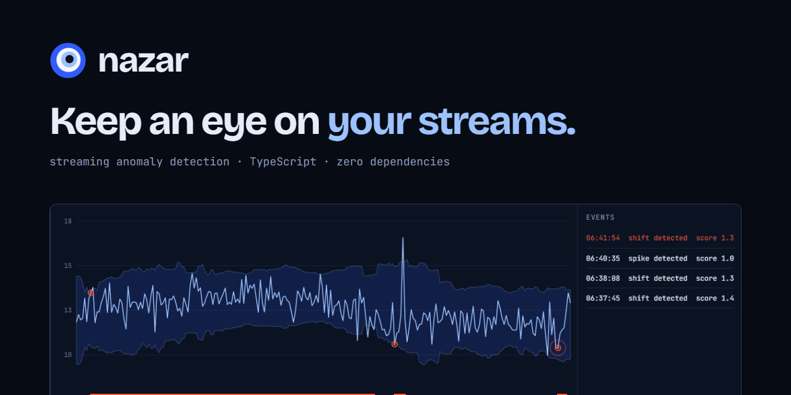
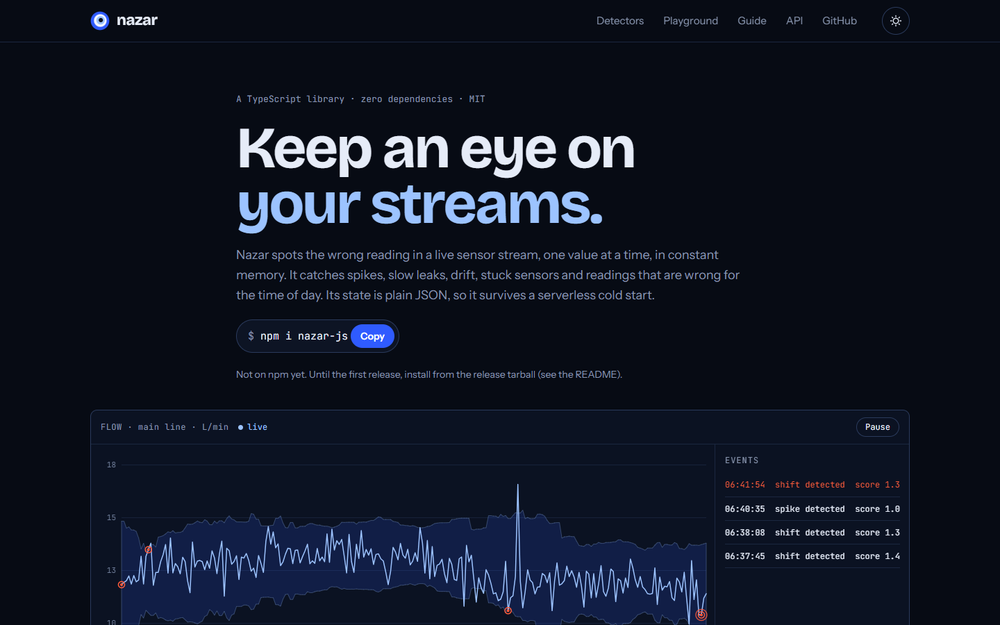
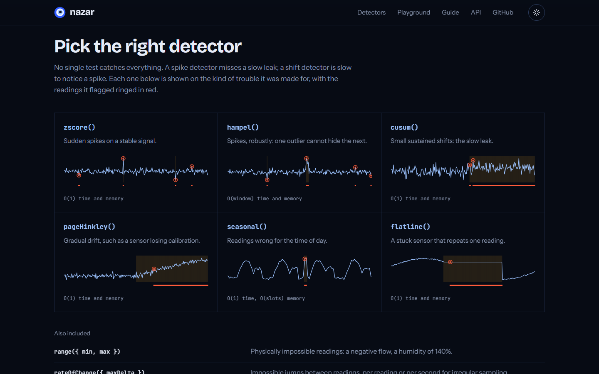
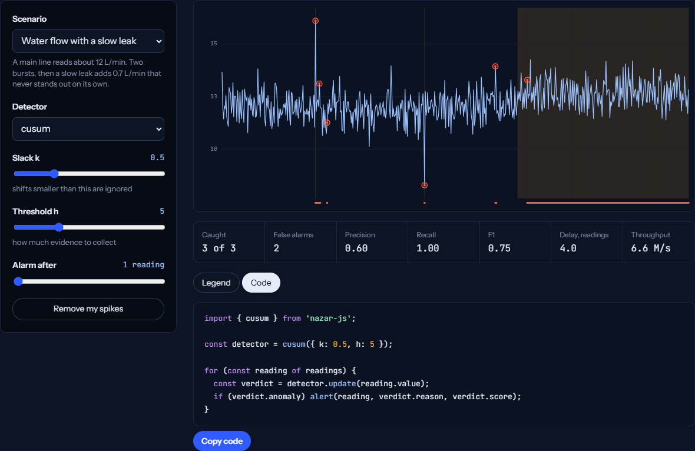
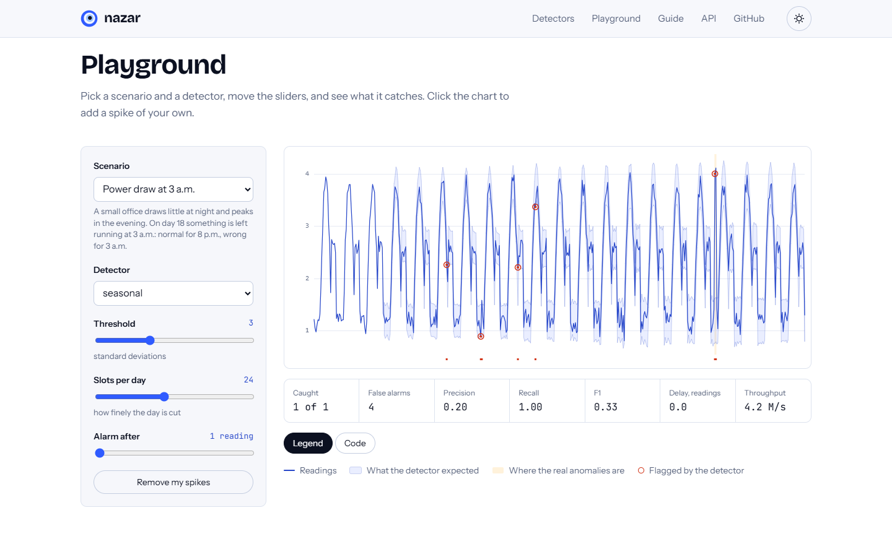
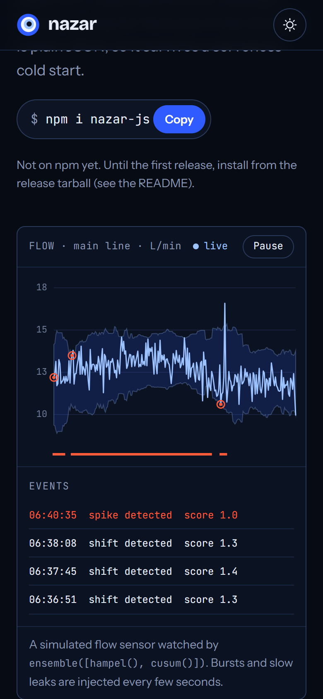
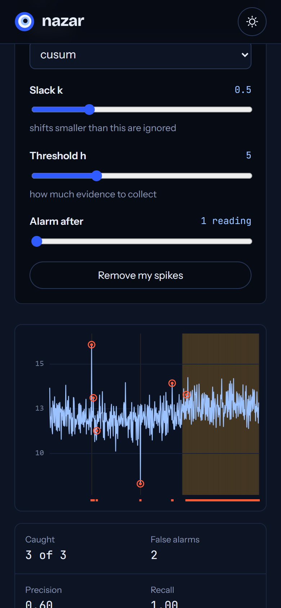
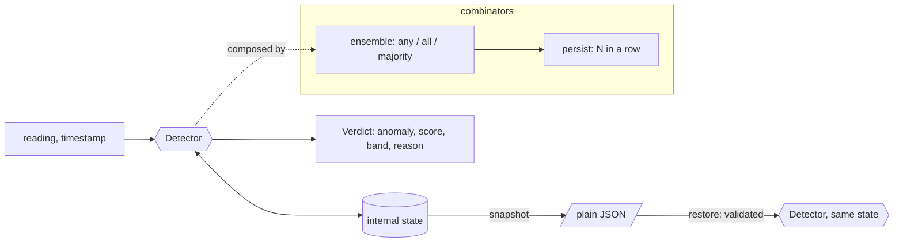

<p align="center"></p>

**Nazar is a small TypeScript library that spots the wrong reading in a live sensor stream: spikes, slow leaks, drift, stuck sensors, and readings that are wrong for the time of day.**

[](https://github.com/Darshanpawar7/nazar/actions/workflows/ci.yml)
[](LICENSE)
[](https://darshanpawar7.github.io/nazar/)



## Why it exists

A sensor reading arrives every few seconds, on an ESP32 gateway, in a serverless function or in a browser tab, and something has to decide right away whether it is wrong. That something cannot keep months of history, cannot pull in a Python stack, and in a serverless function it forgets everything between calls.

Most anomaly detection tools assume a batch of data and a data scientist. Nazar is the other kind: a handful of well-known streaming algorithms behind one small interface. Each judges one reading at a time, in constant memory, and its state is plain JSON you can save and restore. It has zero dependencies and runs anywhere JavaScript runs.

_Nazar_ is the watchful gaze, and the blue glass eye that wards it off.

## Quick start

> Nazar is not on npm yet. Until the first release is published, install it from the release tarball:
>
> ```bash
> npm i https://github.com/Darshanpawar7/nazar/releases/download/v0.1.0/nazar-js-0.1.0.tgz
> ```
>
> After the release, the same package will install as `npm i nazar-js`.

```ts
import { cusum, ensemble, hampel, persist } from 'nazar-js';

// Spikes from hampel, slow leaks from cusum, and only after three flagged readings in a row.
const watch = persist(ensemble([hampel(), cusum()]), { min: 3 });

for (const reading of sensor) {
  const verdict = watch.update(reading.value);
  if (verdict.anomaly) alert(`${verdict.reason}: expected about ${verdict.expected}`);
}
```

Every verdict has the same shape: `anomaly`, a `score` (0 is normal, 1 is the threshold, above 1 is anomalous), `ready` (false while the detector is still learning), and, when the detector has them, the `expected` value, the accepted `lower` and `upper` band, and a `reason`.

## Which detector catches what

| Detector                  | Catches                                            | Cost per reading | Algorithm                                                   |
| ------------------------- | -------------------------------------------------- | ---------------- | ----------------------------------------------------------- |
| `zscore()`                | Sudden spikes on a stable signal                   | O(1)             | Exponentially weighted mean and variance                    |
| `hampel()`                | Spikes, robustly: one outlier cannot hide the next | O(window)        | Rolling median and median absolute deviation (Hampel, 1974) |
| `cusum()`                 | Small sustained shifts: the slow leak              | O(1)             | Two-sided tabular CUSUM on a learned baseline (Page, 1954)  |
| `pageHinkley()`           | Gradual drift, such as lost calibration            | O(1)             | Page-Hinkley test (Page, 1954; Hinkley, 1971)               |
| `seasonal()`              | Readings wrong for the time of day                 | O(1)             | A mean per time slot, with one pooled noise estimate        |
| `flatline()`              | A stuck sensor                                     | O(1)             | Run length within a tolerance                               |
| `range()`                 | Physically impossible readings                     | O(1)             | Hard limits                                                 |
| `rateOfChange()`          | Impossible jumps, per reading or per second        | O(1)             | Bounded first difference                                    |
| `ensemble()`, `persist()` | Combinations, and calm alarms                      | Sum of the parts | Any, all or majority vote; N in a row                       |

**Why several detectors?** In the test suite a sustained shift of one standard deviation is caught by `cusum()` in under 40 readings, while a 3-sigma `zscore()` flags under 5% of the shifted readings. And `cusum()` is slow to notice a one-off spike that `hampel()` flags at once. Pairing them in an `ensemble` covers both.



## The subtleties it handles for you

- **Warm-up.** A detector never raises an alarm before it has seen enough data; `verdict.ready` tells you when it has.
- **It does not learn the leak.** By default (`adapt: 'normal-only'`) flagged readings are left out of the baseline. A detector that keeps learning from what it flags slowly accepts a leak as the new normal; you can choose that with `adapt: 'always'`.
- **Cold starts.** `detector.snapshot()` is plain JSON (a CUSUM snapshot is about 220 bytes). `restore(snapshot)` continues exactly where the original stopped, which a property test checks at random points of random streams.
- **Hostile state.** `restore` treats a snapshot as untrusted input: every field is checked, unknown kinds and over-deep or over-wide trees are refused, and nothing in it can reach `Object.prototype`.
- **Bad readings.** `NaN` and `Infinity` are skipped and counted in `detector.skipped`; they never change the state or raise an alarm.
- **Irregular sampling.** Detectors that care about time take a timestamp with each reading.

## Playground

The [live site](https://darshanpawar7.github.io/nazar/) streams a simulated flow sensor through `ensemble([hampel(), cusum()])`, and its playground runs any detector over four labelled scenarios with live precision, recall, F1 and detection delay. Click the chart to add a spike of your own; the Code tab prints the TypeScript for exactly what you set up, and the address bar holds a shareable link.

| Playground                                                                            | Light theme                                                                                             |
| ------------------------------------------------------------------------------------- | ------------------------------------------------------------------------------------------------------- |
|  |  |

<p align="center">
  
  
</p>

## How it works



Every detector is a small closure over its own state with three methods: `update`, `reset` and `snapshot`. Combinators are detectors too, so they compose freely. Each module keeps its maths separate from its bookkeeping, with configuration validated up front and saved state validated on restore. More detail is in [docs/ARCHITECTURE.md](docs/ARCHITECTURE.md).

Two subpath exports keep the core small:

- `nazar-js/synth`: seeded signals, anomaly injectors (`spike`, `levelShift`, `ramp`, `stuck`) and four labelled scenarios.
- `nazar-js/eval`: `evaluate(flags, labels)` gives event-based precision, recall, F1 and mean detection delay. A leak that lasts an hour is one event, caught or missed.

## Engineering decisions

- **Scores mean the same thing everywhere.** Every detector maps its own statistic to 0 for normal, 1 at threshold, and above 1 for anomalous. Ensembles can then vote and compare across detectors without per-type rules.
- **CUSUM sums are capped at twice the threshold.** An uncapped sum keeps growing through a long leak and then takes ages to come back down. With the cap, the alarm stops soon after the leak is fixed.
- **`seasonal` pools its noise estimate.** With hourly slots each slot sees one reading a day, and a spread estimated from three readings made the first version jumpy (about 8% false alarms in testing). Pooling the noise across slots brought that under 2% while still catching the 3 a.m. anomaly.
- **The median absolute deviation is found in linear time.** The first `hampel` sorted its window on every reading. Merging the deviations outwards from the median gives the same answer about 7 times faster, which a property test checks against sorting.
- **The restore registry is built on first use.** An app that imports one detector and never calls `restore` ships about 1.3 KB brotli instead of the whole library.
- **Closures, not classes.** Detectors are created by plain factory functions. There is no `new`, no inheritance and nothing to subclass, and the public surface is just the `Detector` interface.

## Size and speed

Measured on the built package with esbuild (minified) and Node's zlib, on 11 November 2026:

| Import                        | Minified |   gzip | brotli |
| ----------------------------- | -------: | -----: | -----: |
| The whole library             |  15.3 KB | 5.3 KB | 4.8 KB |
| `cusum` only                  |   3.4 KB | 1.4 KB | 1.3 KB |
| `hampel`, `cusum`, `ensemble` |   6.9 KB | 2.7 KB | 2.4 KB |

`npm run bench` on a 12th-gen Intel Core i5-1240P laptop with Node 24, best of five rounds of 2 million readings. Other work was running on the machine, so treat these as rough:

| Detector                        | Updates per second |
| ------------------------------- | -----------------: |
| `range()`                       |         22 million |
| `zscore()`                      |         17 million |
| `persist(cusum())`              |         15 million |
| `flatline()`                    |         14 million |
| `rateOfChange()`                |         13 million |
| `pageHinkley()`                 |         12 million |
| `seasonal()`                    |         10 million |
| `cusum()`                       |          8 million |
| `hampel({ window: 51 })`        |        1.5 million |
| `ensemble([hampel(), cusum()])` |        0.9 million |

## Getting started with the code

```bash
git clone https://github.com/Darshanpawar7/nazar.git
cd nazar
npm install
npm test              # unit and property tests with coverage
npm run build         # the package, into dist/
npm run site:dev      # the playground, http://localhost:4102
```

| Script                                             | What it does                                                      |
| -------------------------------------------------- | ----------------------------------------------------------------- |
| `npm run build`                                    | Build the package (ESM, CommonJS and type declarations) with tsup |
| `npm test`                                         | Unit and property tests, with coverage thresholds                 |
| `npm run lint` / `npm run typecheck`               | ESLint, Prettier and TypeScript                                   |
| `npm run bench`                                    | Updates per second for every detector                             |
| `npm run site:dev` / `site:build` / `site:preview` | The playground site                                               |
| `npm run e2e`                                      | Browser and accessibility tests against the built site            |
| `npm run screenshots`                              | Re-capture the README images and banner                           |

Runnable examples, after `npm run build`:

```bash
node examples/cold-start.mjs   # 600 serverless "invocations", each restoring from a snapshot
node examples/tune.mjs         # scores cusum thresholds on labelled data
```

## Testing

- **79 unit and property tests.** Every statistic is checked against a slow reference with fast-check: Welford against two-pass variance, the rolling median against sorting, the linear-time MAD against sorting. Every detector is tested on labelled synthetic data with explicit floors: hampel catches at least 95% of 6-sigma spikes with under 1% false alarms, cusum catches a one-sigma shift within 40 readings, and so on. Snapshot and restore are property-tested for every detector and combinator, and restore is fed hostile snapshots. A million-update stability test runs on a large offset.
- **Coverage** (enforced in `vitest.config.ts`, measured on 11 November 2026): 99.35% statements, 97.33% branches.
- **9 browser tests** run against the built site. They cover the live stream, every detector card, every playground control, shareable links (including nonsense in the link), click-to-spike, the theme, a phone layout, and axe scans in both themes with zero serious or critical violations.
- **Packaging** is checked by installing the packed tarball into an empty project and using it from `import`, from `require`, and from TypeScript.

## Project structure

```text
src/
  types.ts          Verdict, Detector, Snapshot
  check.ts          validation of settings and saved state
  stats.ts          Welford, exponentially weighted stats, rolling median and MAD, PRNG
  detectors/        zscore, hampel, cusum, page-hinkley, seasonal, simple (flatline, range, rateOfChange)
  combinators.ts    ensemble, persist
  restore.ts        rebuilds any detector tree from a snapshot
  synth.ts          nazar-js/synth
  eval.ts           nazar-js/eval
test/               unit and property tests
site/               the playground: plain TypeScript and canvas
e2e/                Playwright and axe tests for the site
examples/           runnable Node examples
scripts/            benchmark and screenshots
```

## Roadmap

- Publish 0.1.0 to npm.
- A multivariate detector for readings that are only wrong together, such as flow and pressure.
- A streaming quantile estimator (P-squared) for skewed signals.
- Generated API reference from the TSDoc comments.

## Licence

[MIT](LICENSE)

---

Designed and built by [Darshan Pawar](https://darshanpawar7.github.io) · [GitHub](https://github.com/Darshanpawar7) · [LinkedIn](https://linkedin.com/in/darshanpawar7)
